# Law Firm Decision Support

  

**[▶ Live demo](https://lawfirmoperationsintelliigence-gkymdplvqo2g3smdqcgyxv.streamlit.app)** · [Methodology](docs/METHODOLOGY.md) · [Simulator](docs/SIMULATOR.md) · [Architecture](docs/ARCHITECTURE.md)

**How it started.** A three-office law firm pays about $117K a year for its practice-management and search platforms
(LEAP + InfoTrack). The first question was simple: *which platform would save the firm the most?* Answering it properly needed
the firm's real cost base, utilisation and cash position, and once that model existed it could answer the bigger questions
the partners actually face: **should we hire, restructure, open another branch or switch systems, and can we afford it?**

So this is a decision-support tool, not just a dashboard. Every page fits one laptop screen, and the **★ Decision Simulator**
tests a decision before it is made: the effect on profit, the gap to budget, the cash needed up front and how much of the result
depends on things going to plan.

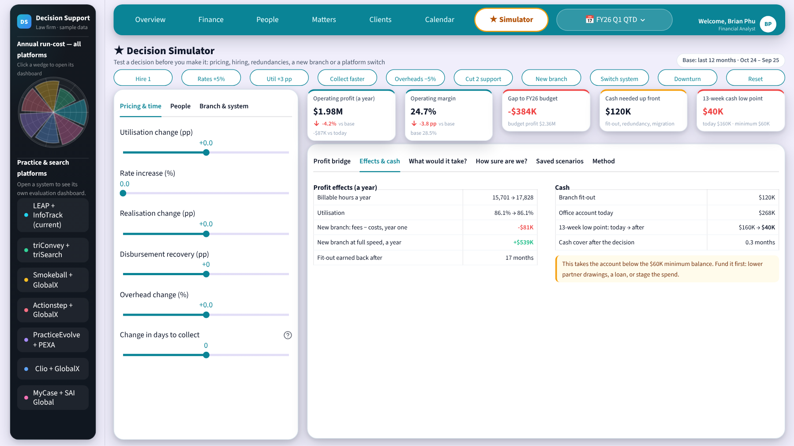

## At a glance

[](https://github.com/brianphu2310/Law_Firm_Operations_Intelliigence/actions)

| | |
|---|---|
| **Decisions it supports** | Switch platform? Hire? Cut roles (with NES redundancy pay)? Open a branch? Raise rates or chase utilisation? |
| **What I built** | A financial model of the firm (P&L vs budget, branch results, working capital, 13-week cash forecast, platform NPV) and a Decision Simulator with goal-seek, delivery-risk and cash checks, over a SQL warehouse fed by a MYOB API → n8n → Snowflake pipeline that reconciles to the cent. |
| **Key results** | Synthetic data: profit is $297K a year short of the FY26 budget. Raising rates 5% closes it; a new branch loses $87K in year one, needs $120K up front and would take the bank account below its minimum; the weakest branch carries 3 support staff per lawyer. |
| **Tech stack** | Python, pandas, Streamlit, Plotly · SQL (SQLite, DuckDB, Snowflake) · REST API + JSON · OAuth 2.0 / JWT (Auth0) · n8n · Excel + Power Query · FastAPI · GitHub Actions |
| **Proof** | 195 automated tests in CI, including the simulator maths, NES redundancy tables and reconciliation checks. |
| **Honest limits** | Fictional firm and synthetic data modelled on real legal-accounts work; no client information. Results depend on stated assumptions and are not legal or financial advice. |

## The four decisions, and where the app answers them

| Decision | Where | What it shows on the sample data |
|---|---|---|
| **Which platform saves the most?** (where the project started) | Sidebar → one evaluation page per platform | Smokeball + GlobalX has the best 3-year NPV (+$106K, payback 17 months); triConvey has the lowest run-cost ($88K a year against $117K today). |
| **Should we hire?** | ★ Simulator → People | A new associate must be about 42% as productive as the firm average in year one just to cover their cost. Hiring one at 60% adds about $120K a year, but loses $81K if only half the expected work turns up. |
| **Should we cut roles?** | People → Branches & staffing, then ★ Simulator → People | Camden has 6 support staff for 2 lawyers and the lowest margin (21%). Cutting two support roles saves $130K a year for about $22K of NES redundancy and notice pay once. Cutting a busy associate *loses* about $128K a year, because their fees go with them. |
| **Should we open a branch?** | ★ Simulator → Branch & system | Two associates and two support staff: −$87K in year one, +$539K a year at full speed, fit-out earned back in 17 months, but the $120K fit-out takes the 13-week cash low point from $160K to $40K, below the $60K minimum. |

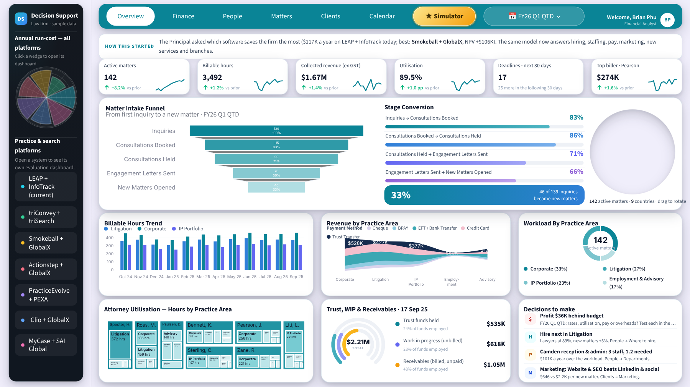

## ★ The Decision Simulator

Built on the last 12 months of actuals, levers on the left, results on the right, all on one screen:

* **One-click decisions:** hire, raise rates, lift utilisation, collect faster, cut overheads, cut two support roles, open a branch, switch platform, or a downturn.
* **People decisions with real rules.** Redundancy and notice pay follow the National Employment Standards (Fair Work Act s 117 and s 119): 4 to 16 weeks of redundancy pay by service, none for an employer with fewer than 15 employees. The firm has 25, so it applies.
* **Cash, not just profit.** Fit-outs, redundancies and migrations are one-off cash. The Simulator shows the cash needed up front, the 13-week low point after the decision and warns when it breaks the minimum balance.
* **"What would it take?" (goal-seek):** closing the $297K gap needs about **+3.7 pp utilisation**, or **+4.3% rates**, or **+3.9 pp realisation**. One click applies the answer.
* **"How sure are we?":** the result if only 100% / 75% / 50% of the uncertain part is delivered. Pay, rent and setbacks are never softened.
* **Saved scenarios** to compare options side by side, with CSV export.

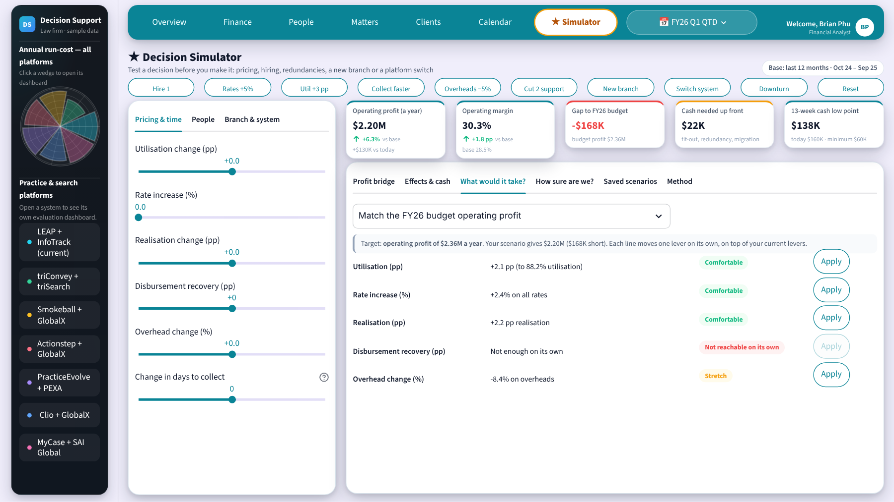

**Every preset on the sample data** (base: last 12 months, $2.07M operating profit a year, 28.5% margin; FY26 budget $2.36M):

| Decision | Profit change a year | Margin | Gap to FY26 budget | One-off cash | If only 50% is delivered |
|---|---|---|---|---|---|
| Raise rates 5% | +$350K | 31.8% | +$53K | — | +$175K |
| Lift utilisation +3 pp | +$243K | 30.8% | −$55K | — | +$121K |
| Cut 2 support roles (3 years' service) | +$130K | 30.3% | −$168K | $22K | +$130K |
| Hire an associate (60% productive in year one) | +$120K | 28.5% | −$177K | — | −$81K |
| Cut overheads 5% | +$99K | 29.9% | −$198K | — | +$50K |
| Switch to Smokeball + GlobalX | +$18K | 28.8% | −$280K | $52K | +$18K |
| Collect 7 days faster | $0 (releases about $153K of cash once) | 28.5% | −$297K | — | $0 |
| Open a branch (2 associates, 2 support) | −$87K in year one | 24.7% | −$384K | $120K | −$451K |
| Downturn: −5 pp utilisation, +3% overheads | −$464K | 23.5% | −$761K | — | −$464K |

Method, formulas and limits: [docs/SIMULATOR.md](docs/SIMULATOR.md).

## Pages

Every page and every tab fits a 13-inch laptop screen (1440 × 810 browser window) without scrolling.

| Page | Question it answers |
|---|---|
| **Overview** | How this started, the headline KPIs and the four decisions to make |
| **Finance** | Are we ahead of budget and why? Where will the year land? Can we afford a decision? (P&L vs budget, FY outlook, cash and 13-week forecast, billing and WIP, trust account, supplier costs) |
| **People** | Headcount, utilisation, realisation, pay economics, and staffing and margin by branch |
| **Matters · Clients · Calendar** | Matter ledger and ageing, client concentration and payment behaviour, court dates |
| **★ Simulator** | What happens if we decide X, and what would it take to hit budget? |
| **Platform pages** (sidebar) | 3-year cost, NPV, payback, weighted scorecard, risks and sensitivity for each of seven platforms |

## Example findings (from the synthetic data)

Quarter-to-date, 1 Jul – 17 Sep 2025:

* **Profit is behind budget even though revenue is growing.** Revenue is $1.63M: 2.9% above the prior period but 1.9% below budget.
  Operating profit is $471K against a $507K budget, and the margin is 29.0% against 30.6%, because costs grew 4.8% against revenue's 2.9%.
* **The full year lands short too.** At current performance FY26 operating profit lands near $2.20M against a $2.36M budget (−7.1%).
* **Cash is the constraint on every growth decision.** Partners draw 98% of profit, so the office account covers only 0.6 months of costs
  and the 13-week forecast dips to about $160K in the week of 23 Oct, when payroll, drawings and the quarterly GST payment fall together.
* **Staffing, not productivity, is Camden's problem.** It has the highest utilisation (93%) but 3 support staff per lawyer and a 21% margin, against 36% at Richmond.
* **Each extra point of utilisation is worth about $81K a year**, so a 3-point improvement recovers about four-fifths of the gap to budget.

## Data engineering: warehouse, SQL and data quality

Besides the Streamlit app, the repo includes a small, tested data pipeline over the same **simulated** data. It loads the app's
fixed-seed model into a SQLite star schema, checks it, and runs SQL analysis on it. Nothing is scraped or fetched; no real client,
matter or billing data is used.

```bash
python -m warehouse.build            # simulated data -> warehouse.db (dim_/fact_ tables, surrogate keys, FKs, indexes)
python -m warehouse.quality          # data-quality suite -> docs/DATA_QUALITY.md
python sql/run_queries.py            # 10 analytical queries -> docs/query_results/*.csv
```

| What | Where |
|---|---|
| ETL module (extract / transform / load, date dimension, pro-rating, wide-to-long) | [`warehouse/build.py`](warehouse/build.py), DDL in [`warehouse/schema.sql`](warehouse/schema.sql) |
| Data-quality checks (nulls, duplicates, referential integrity, business rules, reconciliation to the app's metrics) | [`warehouse/quality.py`](warehouse/quality.py) -> [docs/DATA_QUALITY.md](docs/DATA_QUALITY.md) |
| 10 SQL queries: utilisation, WIP by matter age, realisation, practice-area profitability, matter billing position, client concentration, receivables ageing, payment behaviour, P&L vs budget, trust balances | [`sql/analysis/`](sql/analysis) -> [`docs/query_results/`](docs/query_results) |
| ER diagram, grain and keys | [docs/DATA_MODEL.md](docs/DATA_MODEL.md) |
| Data dictionary and source-to-target mapping | [docs/DATA_DICTIONARY.md](docs/DATA_DICTIONARY.md) |
| Skills mapped to files | [docs/SKILLS_DEMONSTRATED.md](docs/SKILLS_DEMONSTRATED.md) |

Tests for the pipeline are in `tests/test_warehouse.py`, `tests/test_sql_queries.py` and `tests/test_docs.py`; CI builds the warehouse and runs the quality suite and queries on every push.
The simulation has no per-matter cost or time-entry ledger, so WIP ageing is by matter age and profitability is analysed at practice-area level.

## Integration pipeline: MYOB, LEAP, triConvey, InfoTrack, TriSearch, PEXA → n8n → Snowflake → Excel / Power Query, Streamlit

How the dashboard's numbers would arrive from the firm's systems, built end to end and rehearsed on **one platform cut-over** (LEAP to triConvey, InfoTrack to TriSearch): the kind of switch the platform pages evaluate. The pipeline finds what a cut-over leaves behind. Details: [docs/PIPELINE.md](docs/PIPELINE.md) and [docs/TRANSITION.md](docs/TRANSITION.md).

**The pipeline, end to end:** 16 resources from 6 mock vendor APIs into the warehouse, 15 quality checks and 12 reconciliations to the app all pass, and 28 cut-over findings land in the exceptions log. [MP4](docs/media/02_pipeline_run.mp4)

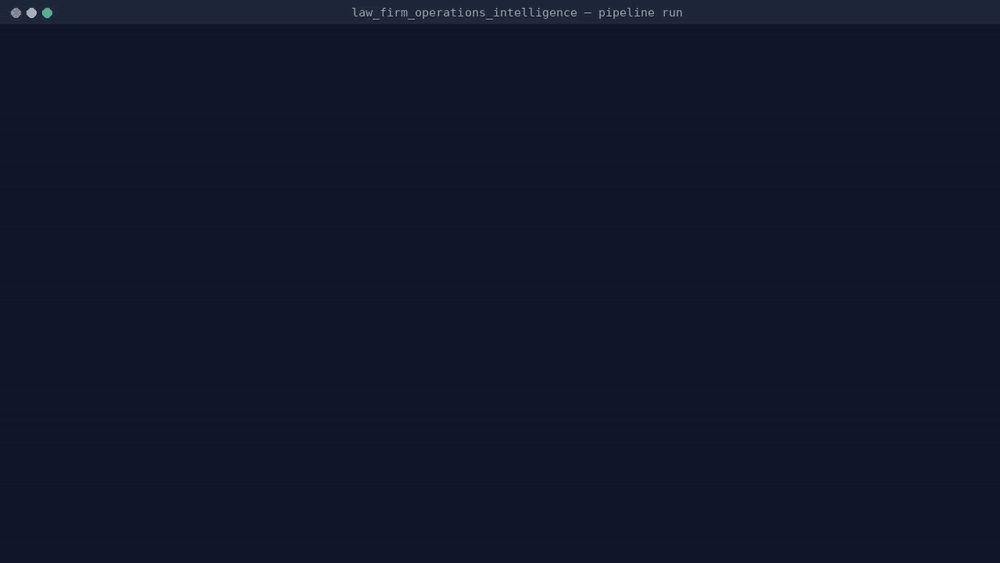

**The same load, live in the cloud:** n8n Cloud gets an Auth0 token, pulls 16 resources from the mock vendor APIs on Render and writes 7,927 records into Snowflake, every node green.

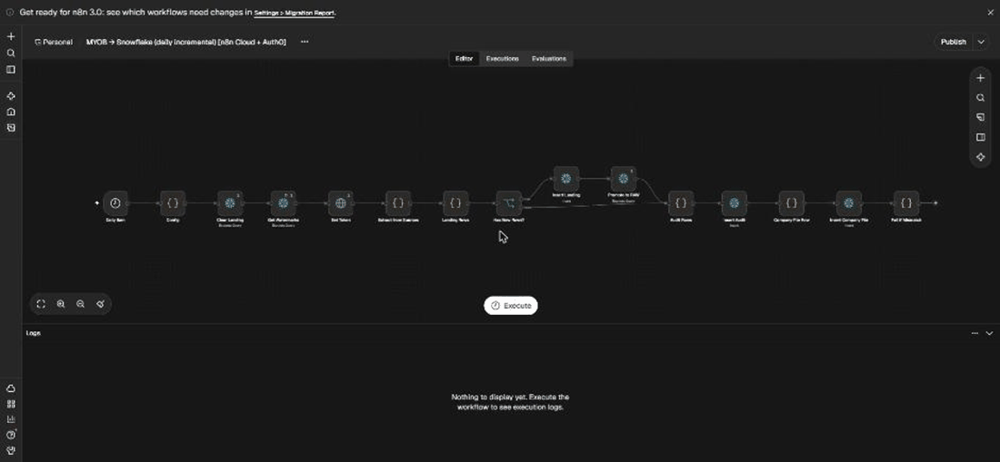

The cut-over is also documented the way a Business Analyst would run it: a [BRD](docs/ba/BRD.md), [stakeholder map and RACI](docs/ba/STAKEHOLDERS.md), [process maps](docs/ba/PROCESS_MAPS.md), [UAT cases](docs/ba/UAT.md) and a [cut-over runbook](docs/ba/CUTOVER_RUNBOOK.md).

| Stage | Tool | Where |
|---|---|---|
| Sources | Six simulated systems, each with its own API and paging style: **MYOB** (accounting), **LEAP** (practice management, frozen at the final collection), **triConvey** (Smokeball-shaped, live from go-live), **InfoTrack** (searches until go-live), **TriSearch** (searches after go-live), **PEXA** (settlements) | [`integration/mock_api.py`](integration/mock_api.py), [`integration/sources_export.py`](integration/sources_export.py), [`integration/myob_export.py`](integration/myob_export.py) |
| Cross-system checks | LEAP + triConvey invoices = MYOB (472/472); the cut-over reconciliation finds **28 planted findings**: 1 unmigrated matter, 1 duplicate, 12 Advisory matters that fell to "General", 1 invoice missing GST, a **$5,799.21 trust gap** that leaves the August r48 ledger statement unbalanced with 2 working days left, and 22 supplier-switch disbursement exceptions (18 TriSearch orders never reached the ledger) | [`integration/sql/`](integration/sql), [docs/PIPELINE.md](docs/PIPELINE.md) |
| Security | **OAuth 2.0 client credentials** with RS256 JWTs: **Auth0** (free) or a local issuer for CI; signature via JWKS, issuer, audience, expiry, per-resource scopes; RFC 6750 errors. 20 tests incl. forged, alg-none, HS256-confusion, expired and wrong-scope tokens | [`integration/auth.py`](integration/auth.py), [docs/AUTH.md](docs/AUTH.md) |
| Orchestration | **n8n**: daily 6am, incremental watermarks, landing → RAW with `INSERT ALL … PARSE_JSON`, load audit, fails on count mismatch | [`integration/n8n/`](integration/n8n) |
| Warehouse | **Snowflake**: stage + `COPY INTO`, `VARIANT`, `LATERAL FLATTEN`, `QUALIFY` de-duplication, marts (DuckDB twin for local runs and CI) | [`integration/sql/`](integration/sql) |
| Quality | 15 checks + 12 reconciliations to the dashboard (receivables, every ageing bucket, monthly revenue, trust and matters across the freeze) | [`integration/quality.py`](integration/quality.py) → [docs/PIPELINE_QUALITY.md](docs/PIPELINE_QUALITY.md) |
| Excel + Power Query | 4 cross-system checks that read the source JSON straight from this repo, plus M scripts for the marts API, the MYOB API (paged) and Snowflake, and a formula-driven Debtors & Revenue Pack. [`Law_Firm_Recon_PowerQuery.xlsx`](integration/excel/Law_Firm_Recon_PowerQuery.xlsx) was refreshed in Excel on the cut-over data (20 Nov 2026): 472/472 invoices matched; 132 matters migrated, M-2024-0209 not migrated, M-2024-0277 duplicated; Global Trust Bank −$5,799.21; 439 matters, $213,752.16 of disbursements. The same results as DuckDB and Snowflake | [`integration/powerquery/`](integration/powerquery), [`integration/excel/`](integration/excel) |
| Serving and BI | Marts JSON API (FastAPI) and Excel + Power Query | [`integration/marts_api.py`](integration/marts_api.py) |

**Evidence** (screenshots from the real runs):

**Cut-over run, 20 Nov 2026** (n8n Cloud → Snowflake, staging and marts built in Snowflake straight from this repo with a Git repository stage and `EXECUTE IMMEDIATE FROM`):

| | |
|---|---|
| 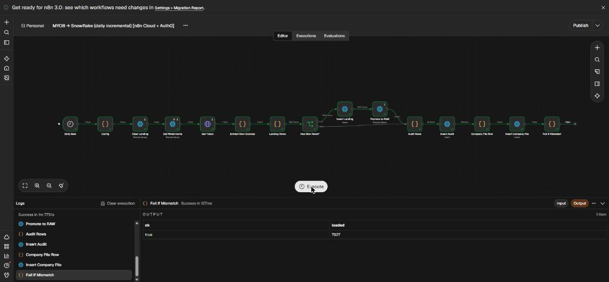 **n8n Cloud:** 16 resources, 7,927 records, all nodes green, API count = loaded count | 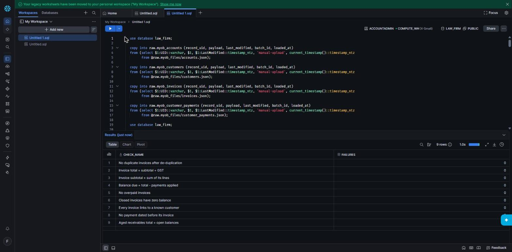 **Snowflake:** the load audit for that run, 16/16 resources OK |
| 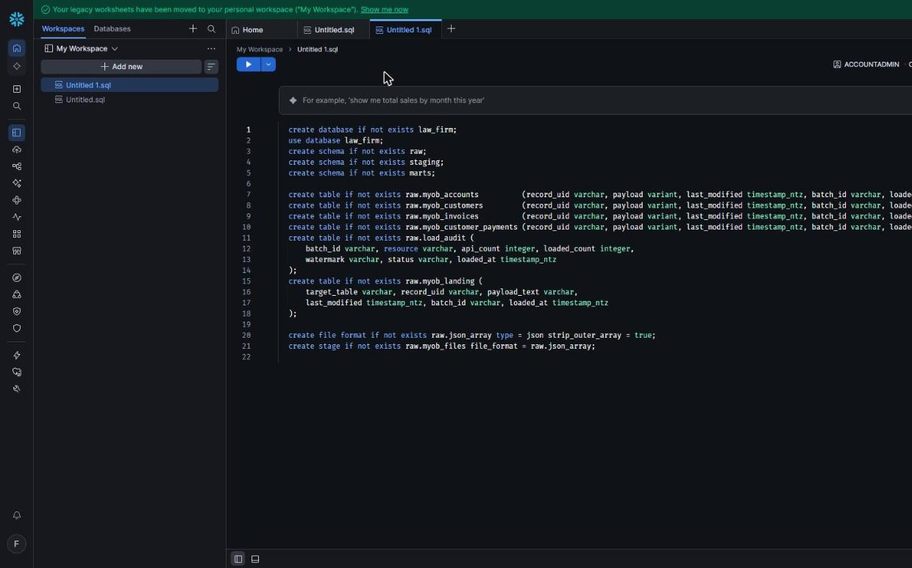 **Snowflake:** 28 cut-over findings (22 disbursement, 2 matter, 1 matter type, 1 invoice, 1 trust balance, 1 trust reconciliation), the same as the local DuckDB run | 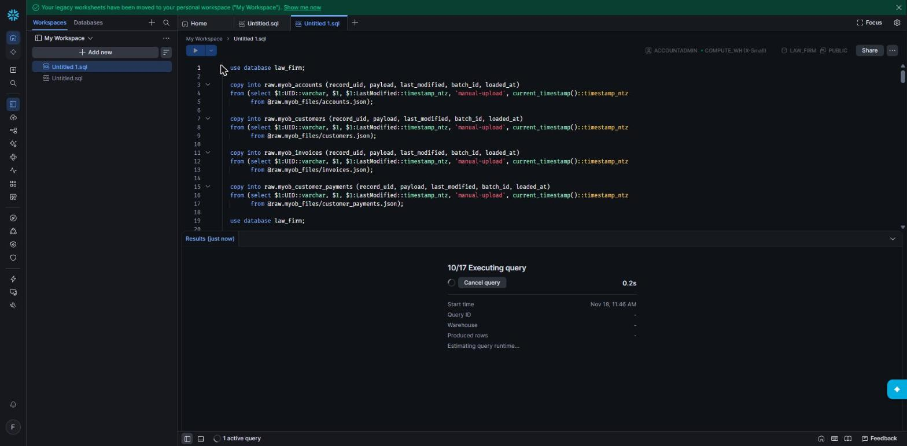 **Snowflake:** the exceptions log, led by the August r48 reconciliation $5,799.21 off |

**Earlier single-system run** (before the cut-over was modelled):

| | |
|---|---|
| 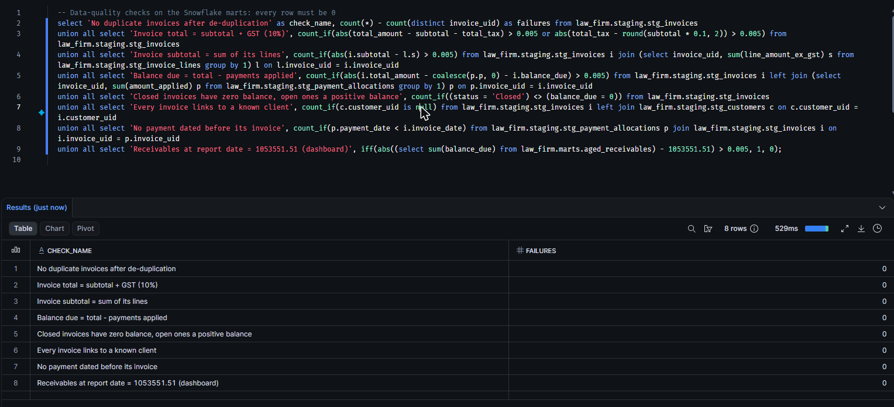 **Snowflake:** 8 quality checks on the loaded data, all 0 failures | 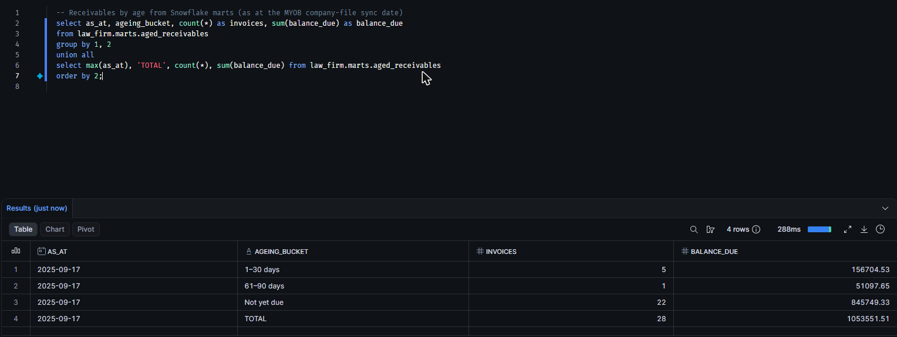 **Snowflake:** receivables by age, total $1,053,551.51, same as the dashboard |
| 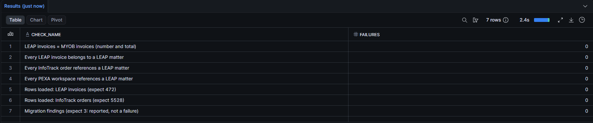 **Snowflake:** cross-system checks on LEAP, MYOB, InfoTrack and PEXA data, all 0 | 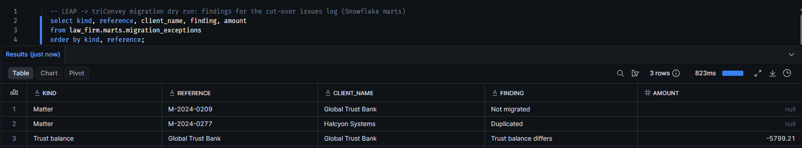 **Snowflake:** the same 3 migration findings as the local run |
| 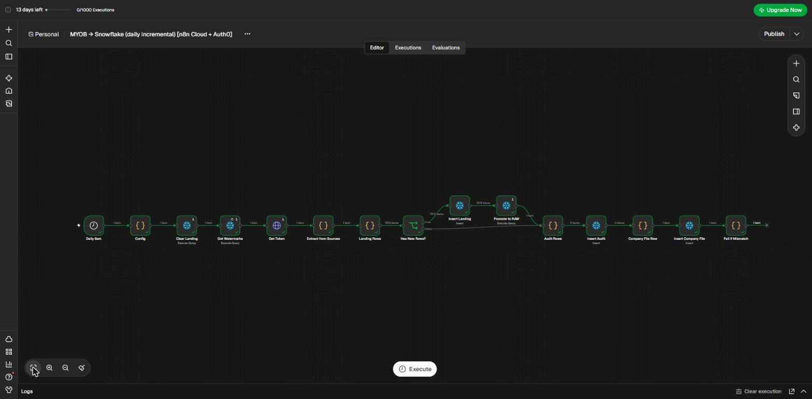 **n8n Cloud, end-to-end run:** Auth0 client-credentials token → mock vendor API on Render → 7,572 records into Snowflake, all 15 nodes green | 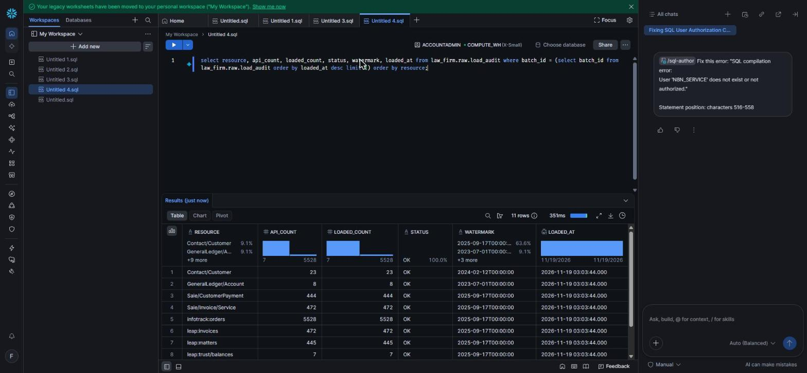 **Snowflake:** the load audit written by that run, 11/11 sources OK, API count = loaded count |
| 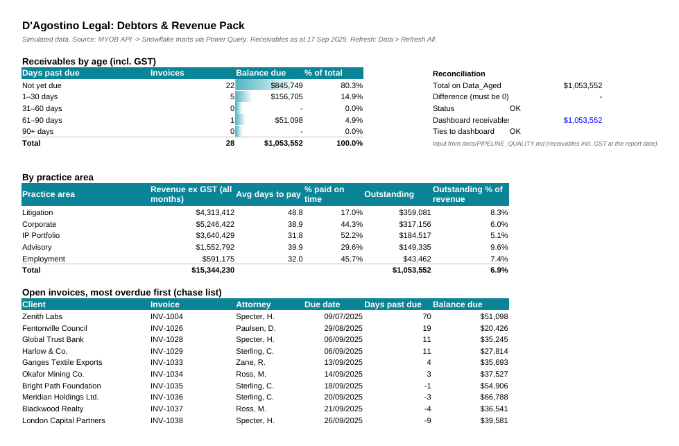 **Excel:** Debtors & Revenue Pack, formulas only, tie-out cells read OK | |

**Result:** 11 resources from 5 systems (7,572 records) load with every check at 0 failures. Receivables at the 17 Sep 2025
report date are **$1,053,551.51** in the pipeline against $1,053,551.56 in the app, a 5-cent gap from per-invoice cent rounding.
The ageing buckets and monthly revenue also tie out.
**Evidence note:** the cut-over SQL has now run on Snowflake and finds the same 28 findings as DuckDB. The Excel Power Query workbook was refreshed on the same data and agrees.
**Honest limit:** every source system is a mock serving a re-shaped copy of the app's simulated data. No real firm or client
data is used. The LEAP, InfoTrack, TriSearch and PEXA API shapes are illustrative because those vendors gate or do not publish their API references. Supplier service fees are assumptions, not published prices. Live
connections need vendor developer access, and switching to them is configuration, not code.

```bash
pip install -r requirements-pipeline.txt
uvicorn integration.mock_api:app --port 8000 &        # mock MYOB API
python -m integration.extract_load                     # API -> warehouse RAW (incremental)
python -m integration.quality                          # staging, marts, checks, reconciliation
python -m integration.excel.build_pack                 # Excel Debtors & Revenue Pack
```

## More screenshots

| | |
|---|---|
| 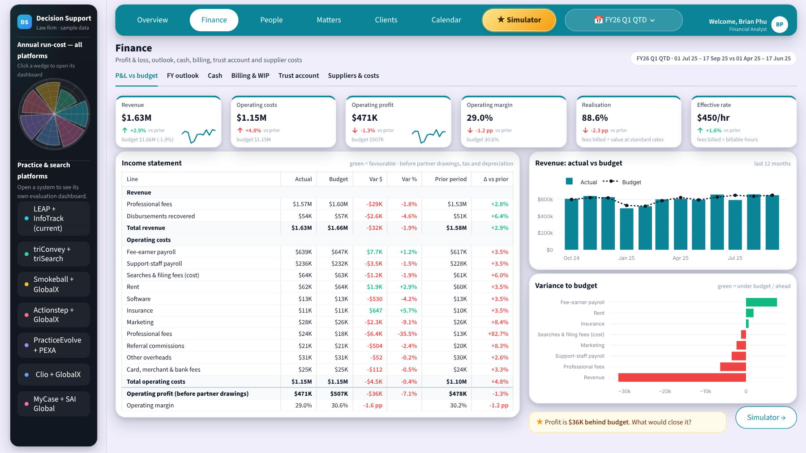 **P&L vs budget** (with a link into the Simulator) | 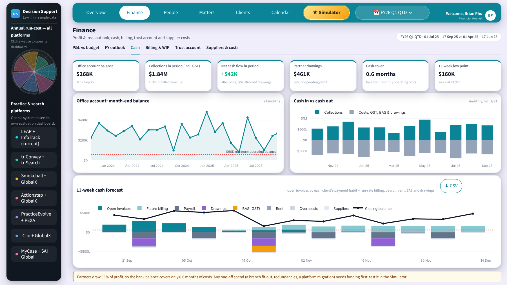 **Cash and 13-week forecast** |
| 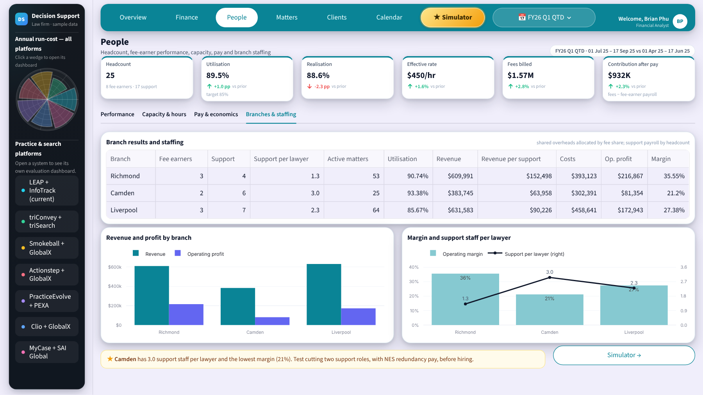 **People: branches and staffing** | 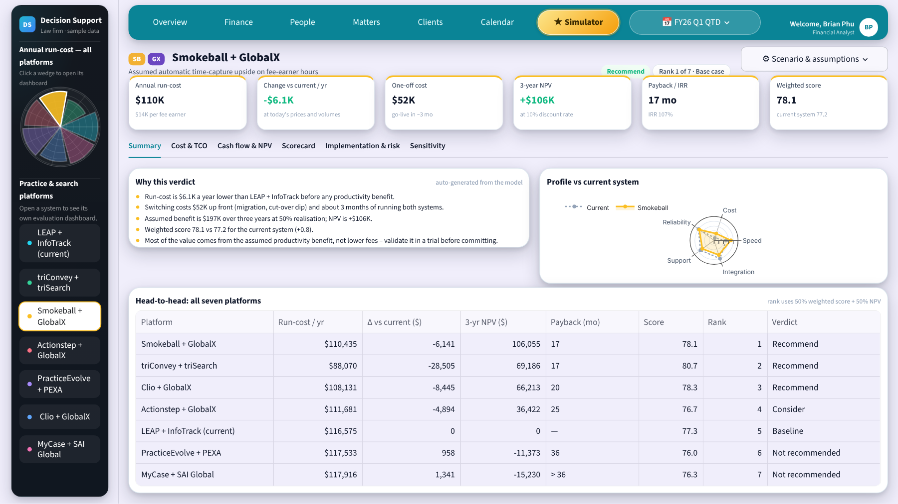 **Platform evaluation (one per platform)** |
| 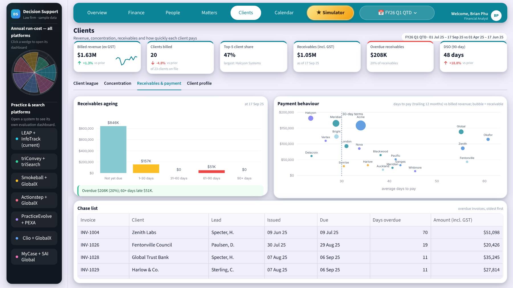 **Receivables and payment behaviour** | |

## What this project demonstrates

**Financial analysis**
* Decision analysis: platform NPV, hiring break-even, redundancy cost under the NES, new-branch payback, goal-seek ("what would it take?"), delivery-risk haircuts and the cash impact of each decision.
* Management reporting: income statement with actual vs budget vs prior period, favourable/unfavourable variance logic.
* Legal-industry KPIs: utilisation, realisation, effective rate, WIP, lock-up days, DSO, matter ageing.
* Working capital and cash: receivables ageing, expected-collection modelling, a 13-week cash forecast, GST/BAS timing.
* Trust-account awareness: client trust money is kept separate from firm revenue and cash, with per-client ledgers.
* Investment appraisal: 3-year TCO, NPV, IRR, payback, scenarios (base / downside / upside), sensitivity and break-even analysis.
* Reporting periods done properly: month-to-date, quarter-to-date, Australian financial year (1 Jul – 30 Jun), custom ranges.

**Engineering**
* Python, pandas, NumPy, Plotly and Streamlit; about 4,400 lines organised into a model layer, a metrics layer, a simulation engine and page modules.
* One deterministic financial model as the single source of truth, so every page reconciles to every other page.
* **195 automated tests** (the app, the simulator, the pipeline, the warehouse, SQL and documentation suites): reconciliation checks (for example, the invoice ledger equals modelled revenue to the dollar, branch and attorney tables sum to firm totals),
  simulator maths (goal-seek answers land exactly on the target), and browser-style tests that click buttons and edit controls, including regression tests for past bugs.
* A SQLite dimensional warehouse with a data-quality suite and SQL analysis layer (see **Data engineering** above).
* An API-to-warehouse integration layer (MYOB API, n8n, Snowflake, Power Query) reconciled to the app (see **Integration pipeline** above).
* Continuous integration on GitHub Actions.

Method notes: [docs/METHODOLOGY.md](docs/METHODOLOGY.md) (every KPI and model formula) · [docs/SIMULATOR.md](docs/SIMULATOR.md) (the Simulator) · [docs/ARCHITECTURE.md](docs/ARCHITECTURE.md) (how the code fits together).

## Run it locally

```bash
git clone https://github.com/brianphu2310/Law_Firm_Operations_Intelliigence.git
cd Law_Firm_Operations_Intelliigence
python -m venv .venv && source .venv/bin/activate      # Windows: .venv\Scripts\activate
pip install -r requirements.txt
streamlit run app.py
```

Tested with Python 3.12, Streamlit 1.64, pandas 3.0, NumPy 2.4–2.5 and Plotly 7.1. Best viewed in a browser window at least 1280 px wide.
The model builds in about two seconds and is cached. The globe on the Overview page loads its map from Plotly's CDN, so it needs an internet connection.

**Tests:** `pip install -r requirements-dev.txt && python -m pytest -q`

## Deploy your own copy (free)

1. Push the repository to your GitHub account.
2. Go to [share.streamlit.io](https://share.streamlit.io), sign in with GitHub and choose **New app**.
3. Select the repository, branch `main`, main file `app.py`; under *Advanced settings* choose Python 3.12.
4. Optionally add the resulting URL to the top of this README as a live-demo link.

## Data, assumptions and disclaimers

* **All data is synthetic.** The firm, its clients, matters and staff are fictional. A fixed random seed makes the data
  reproducible, and the model is calibrated so headline balances on the as-of date (17 Sep 2025) are exact:
  142 active matters, office cash $268,400, trust funds $535,000.
* **Simulator results are decision aids, not forecasts.** They hold volumes, mix and client behaviour constant except for the levers you change, and assume enough work exists for any new hire.
* **Platform figures are illustrative.** Prices, scores, migration costs and productivity uplifts for the seven platforms are
  assumptions for demonstrating the method. They are not vendor quotes or facts, and the analysis should be re-run with
  real quotes before it informs a decision.
* Product names such as LEAP, InfoTrack, Smokeball, Actionstep, Clio and MyCase belong to their owners. This project is not
  affiliated with or endorsed by any of them.
* Cash cover looks short because partners draw most of each month's profit. The budget's fixed lines carry the assumptions made
  before the year (a pay rise not yet given, a rent review not yet triggered), so they differ slightly from actuals.
* Redundancy and notice pay use the NES minimums only. Awards, enterprise agreements and contracts can give more; this is not legal advice.
* Operating profit is shown before partner drawings, income tax and depreciation.

## Development notes

This project was developed iteratively with AI assistance (Anthropic's Claude) working from the author's requirements and
feedback on screenshots. The financial definitions are documented in [docs/METHODOLOGY.md](docs/METHODOLOGY.md) and are
covered by the automated tests, so they can be checked and challenged independently of how the code was written.

## Author

Built by Brian Phu. Licensed under the [MIT License](LICENSE).
