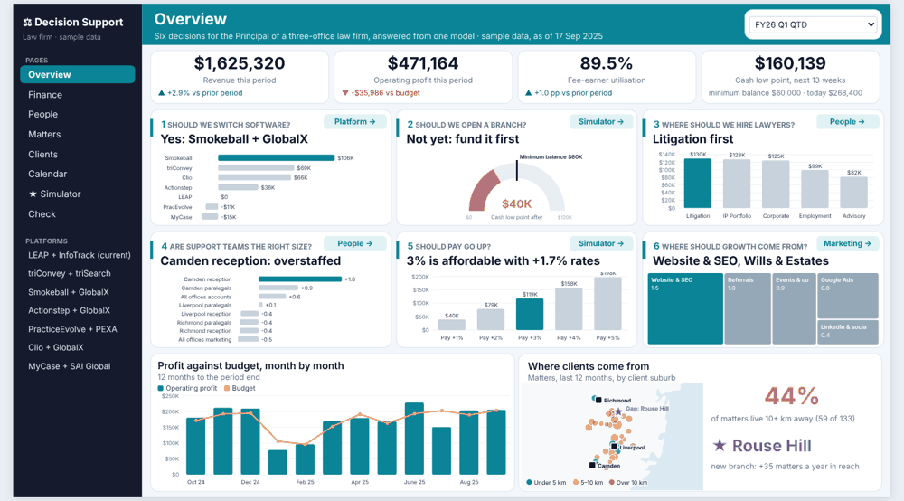
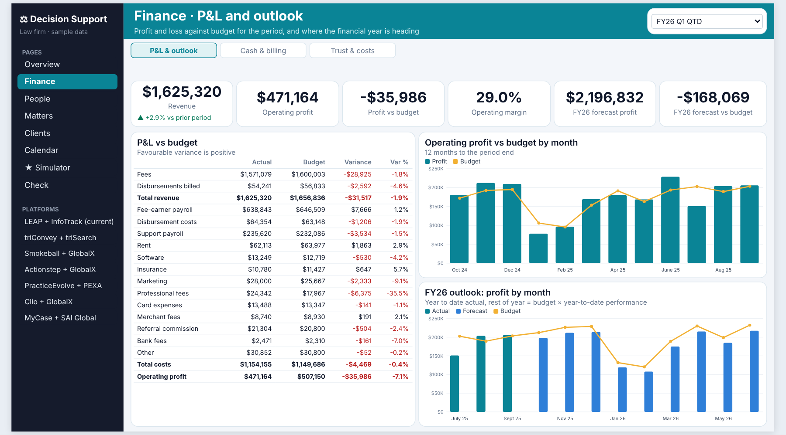
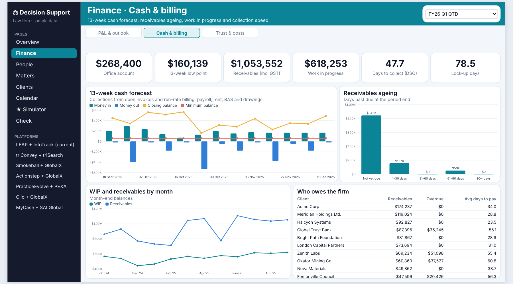
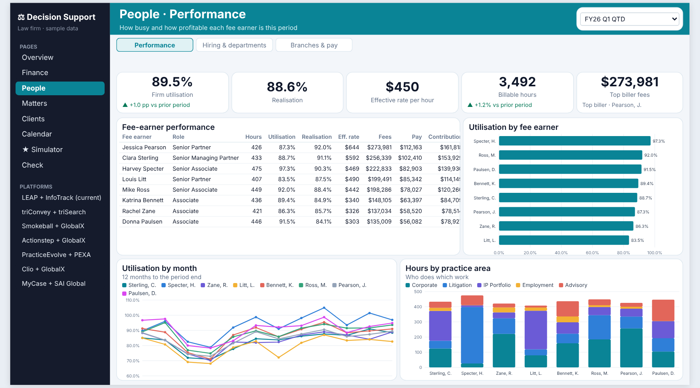
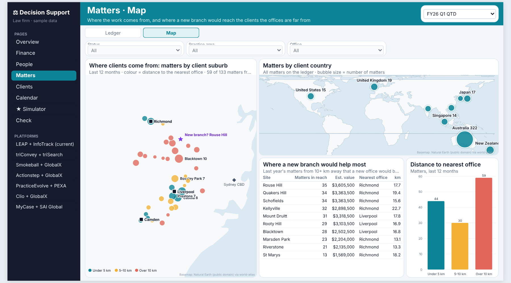
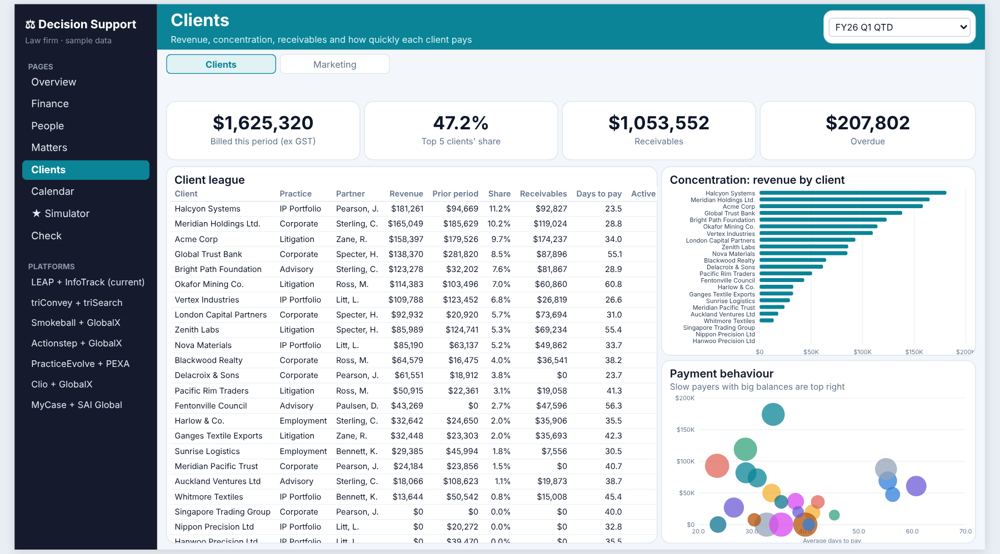
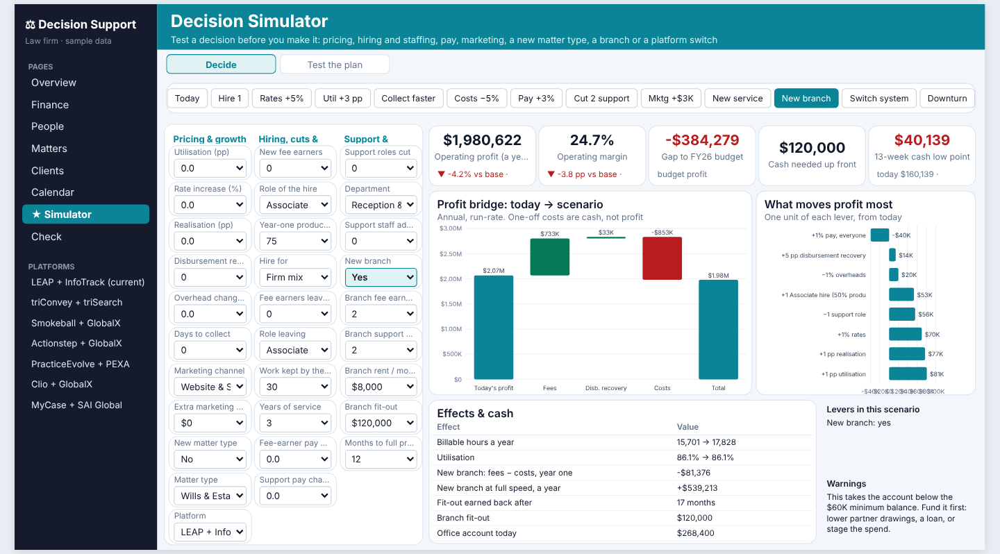
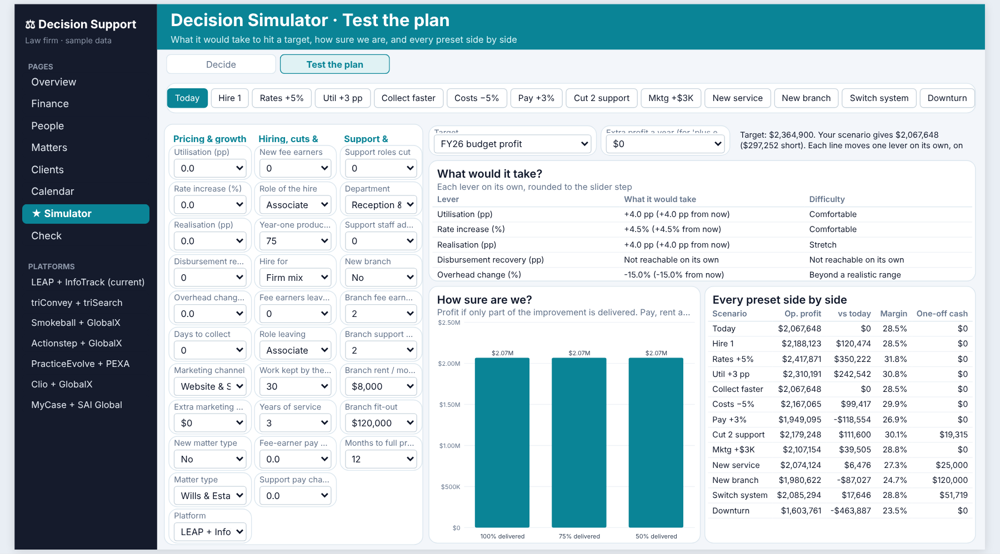
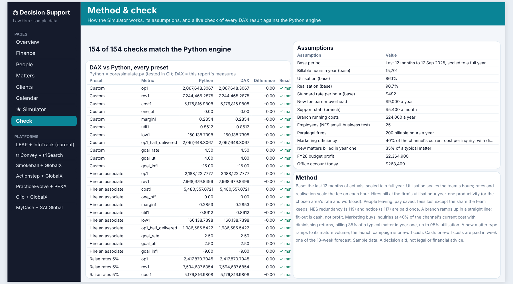
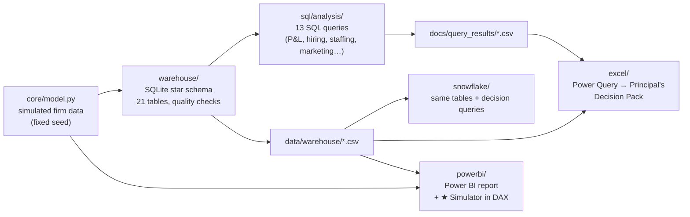

# Law Firm Decision Support

    

**[▶ Open the live dashboard](https://brianphu2310.github.io/law-firm-decision-support/)** (no sign-in, works on phone) · [Power BI files & how to open them](docs/POWERBI.md) · [Business analysis pack](docs/ba/README.md) · [Simulator](docs/SIMULATOR.md) · [Methodology](docs/METHODOLOGY.md) · [Data model](docs/DATA_MODEL.md)

[](https://brianphu2310.github.io/law-firm-decision-support/)

*The live link is a browser preview generated from the Power BI report's own page files (same layout, same numbers, Simulator runs live). The report itself is in [`powerbi/`](powerbi/) as a Power BI Project (.pbip).*

**The brief.** The Principal of a three-office law firm needs to decide what to do next and wants the numbers behind each
decision in one place:

1. Should we **switch practice-management software**, and to which one?
2. Should we **open another branch**?
3. Should we **hire lawyers**, and for **which type of matter**?
4. Are the **support teams** (reception, paralegals, accounts, marketing) the right size, or should we **add or cut roles**?
5. Should **pay go up or down**, and what can we afford?
6. Where is **marketing** working, and should we **open a new type of matter** (wills, family law, conveyancing)?

The project started with question 1 (the firm pays about $117K a year for LEAP + InfoTrack). Answering it properly needed the
firm's cost base, utilisation and cash position, and once that model existed it could answer the rest. Everything is brought
together in one Power BI report, and the **★ Decision Simulator** tests each decision before it is made: profit, the gap to budget,
the cash needed up front and how much depends on things going to plan.

## At a glance

[](https://github.com/brianphu2310/law-firm-decision-support/actions)

| | |
|---|---|
| **What it does** | Brings the firm's finance, people, matters, clients and marketing data together and answers the Principal's six questions, each with a recommendation and a what-if. |
| **How it is built** | Python model → **SQL** star schema and 14 analysis queries (SQLite locally, the same tables and decision queries in **Snowflake**) → **Excel + Power Query** decision pack → **Power BI** report (22 pages incl. a matter map, Simulator in DAX). |
| **Key answers** | Hire in Litigation first. Camden carries 1.8 more reception roles than its workload needs. Website & SEO wins a new matter for $646, LinkedIn for $2,243. A branch pays back in 17 months but needs funding first. |
| **Tech stack** | Python (pandas, NumPy) · SQL (SQLite, Snowflake) · Excel + Power Query · Power BI (DAX, TMDL/PBIR) · pytest · GitHub Actions |
| **Proof** | 130+ automated tests in CI. The SQL answers and the Simulator's DAX formulas are tested against the Python engine, the report files against Microsoft's Power BI schemas, and the Excel summary recalculates to the same figures. |
| **Honest limits** | Fictional firm and synthetic data, modelled on real legal-accounts work; no client information. Department benchmarks, marketing mix and new-service figures are stated assumptions. Not legal or financial advice. |

## Screenshots

<table>
<tr><td width="50%"><a href="docs/screenshots/01_overview.png"></a><br><sub>Overview: the six decisions</sub></td><td width="50%"><a href="docs/screenshots/02_finance_pl.png"></a><br><sub>Finance · P&L</sub></td></tr>
<tr><td width="50%"><a href="docs/screenshots/03_cash_billing.png"></a><br><sub>Finance · Cash & billing</sub></td><td width="50%"><a href="docs/screenshots/04_people.png"></a><br><sub>People · Performance</sub></td></tr>
<tr><td width="50%"><a href="docs/screenshots/05_matters_map.png"></a><br><sub>Matters · Map: where clients come from</sub></td><td width="50%"><a href="docs/screenshots/06_clients.png"></a><br><sub>Clients</sub></td></tr>
<tr><td width="50%"><a href="docs/screenshots/07_simulator_decide.png"></a><br><sub>★ Simulator: a new branch tested</sub></td><td width="50%"><a href="docs/screenshots/08_simulator_test.png"></a><br><sub>Simulator · Test the plan</sub></td></tr>
<tr><td width="50%"><a href="docs/screenshots/09_method.png"></a><br><sub>Method & check</sub></td></tr>
</table>

## The Principal's questions and the answers

| Question | Where | Answer on the sample data |
|---|---|---|
| **Switch software?** | Platform | Smokeball + GlobalX has the best 3-year NPV (+$106K, payback 17 months). triConvey has the lowest run-cost ($88K a year against $117K today). |
| **Open a branch?** | ★ Simulator (Growth levers) | Two associates and two support staff: −$87K profit in year one, +$539K a year at full speed, fit-out earned back in 17 months. But the $120K fit-out takes the 13-week cash low point from $160K to $40K, below the $60K minimum. Fund it first. |
| **Hire, and for which matters?** | People → Hiring & departments | **Litigation**: its lawyers are at 89% utilisation, the highest of the five areas, with a 60% margin. One associate there adds about $130K in year one, against $82K in Advisory. |
| **Support teams the right size?** | People → Hiring & departments | Camden has 3 reception/admin staff for 1.2 roles of work and 2 paralegals for 1.1. Richmond is stretched. Cutting two Camden reception roles saves $112K a year for $19K of NES redundancy and notice pay once. |
| **Pay up or down?** | ★ Simulator (pay levers), People → Branches & pay | Every 1% on everyone's pay costs about $40K a year. A 3% rise (just under market wage growth of 3.4%) costs $119K and would need rates up about 1.7% to pay for it. |
| **Marketing and new matter types?** | Clients → Marketing, ★ Simulator | Website & SEO wins a matter for $646; LinkedIn & social for $2,243 and loses money if increased. Wills & Estates is the best new service: break-even in year one, +$286K a year at full speed, launch paid back in 13 months. |

## ★ The Decision Simulator

Built on the last 12 months of actuals. In Power BI: a preset bar, 30 lever slicers on the left (Pricing & growth · Hiring, cuts & pay · Support & branch), results on the right; a second page tests the plan.

* **Pricing:** rates, utilisation, realisation, disbursement recovery, overheads, days to collect.
* **People & pay:** hire by practice area and role; fee earners leaving; support staff added or cut by department, with NES redundancy and notice pay (Fair Work Act s 117, s 119; employers with fewer than 15 employees are generally exempt, this firm has 25); pay changes for fee earners and support staff, and the rate rise that would pay for them.
* **Growth:** extra marketing by channel (diminishing returns, capped by the team's capacity), a new matter type, a new branch, a platform switch.
* **Cash, not just profit:** the cash needed up front (fit-out, redundancies, launch campaign, migration) and the 13-week cash low point after the decision.
* **What would it take?** Closing the $297K gap to budget needs about **+3.7 pp utilisation**, or **+4.3% rates**, or **+3.9 pp realisation**.
* **How sure are we?** The result if only 100% / 75% / 50% of the uncertain part is delivered. Pay, rent and setbacks are never softened.

**Every preset on the sample data** (base: last 12 months, $2.07M operating profit a year, 28.5% margin; FY26 budget $2.36M):

| Decision | Profit a year | Margin | Gap to budget | One-off cash | If only 50% delivered |
|---|---|---|---|---|---|
| Raise rates 5% | +$350K | 31.8% | +$53K | — | +$175K |
| Lift utilisation +3 pp | +$243K | 30.8% | −$55K | — | +$121K |
| Hire an associate (firm mix, 60% productive in year one) | +$120K | 28.5% | −$177K | — | −$81K |
| Cut 2 reception roles (3 years' service) | +$112K | 30.1% | −$186K | $19K | +$112K |
| Cut overheads 5% | +$99K | 29.9% | −$198K | — | +$50K |
| Extra $3,000 a month on Website & SEO | +$40K | 28.8% | −$258K | — | +$2K |
| Switch to Smokeball + GlobalX | +$18K | 28.8% | −$280K | $52K | +$18K |
| Open Wills & Estates | +$6K in year one | 27.3% | −$291K | $25K | −$156K |
| Collect 7 days faster | $0 (releases about $153K of cash once) | 28.5% | −$297K | — | $0 |
| Open a branch (2 associates, 2 support) | −$87K in year one | 24.7% | −$384K | $120K | −$451K |
| Pay rise 3% (everyone) | −$119K | 26.9% | −$416K | — | −$119K |
| Downturn: −5 pp utilisation, +3% overheads | −$464K | 23.5% | −$761K | — | −$464K |

## How the information comes together



| Layer | What it does | Where |
|---|---|---|
| **SQL** | A star schema (dimensions for date, office, client suburb, practice area, fee earner, client, matter, department, marketing channel; facts for invoices, time, P&L, trust, staffing, intake, supplier orders) with a data-quality suite and 14 analysis queries. Queries 11–14 answer the hiring, staffing, marketing and branch-site questions and are **tested against the dashboard's own numbers**. | [`warehouse/`](warehouse), [`sql/analysis/`](sql/analysis), [docs/DATA_MODEL.md](docs/DATA_MODEL.md), [docs/DATA_DICTIONARY.md](docs/DATA_DICTIONARY.md), [docs/DATA_QUALITY.md](docs/DATA_QUALITY.md) |
| **Snowflake** | The same 21 tables created and loaded from `data/warehouse/*.csv` (stage + `COPY INTO`), and the decision queries in Snowflake SQL. Both scripts are generated from the local schema and queries, so they cannot drift. | [`snowflake/`](snowflake) |
| **Excel + Power Query** | The Principal's Decision Pack: five data sheets (P&L, where to hire, staffing, marketing, receivables) and a summary that is formulas only. Power Query refreshes the data sheets straight from this repository, and one query rebuilds staffing by merging three warehouse tables. | [`excel/`](excel) |
| **Power BI** | The full dashboard and Decision Simulator as a Power BI project: one semantic model over the warehouse, about 295 DAX measures, 22 pages (one per platform, plus a catchment map that shows where a new branch would reach the most clients). The Simulator's formulas are generated from one spec that is tested against the Python engine, and a Check page compares every DAX result with it. | [`powerbi/`](powerbi) · [docs](docs/POWERBI.md) |
| **Python** | The engine behind everything: the simulated firm, the metric definitions and the Simulator (`core/simulate.py`), which the SQL and DAX results are tested against. | [`core/`](core) |

```bash
python -m warehouse.build          # SQLite warehouse -> warehouse.db
python -m warehouse.quality        # data-quality suite -> docs/DATA_QUALITY.md
python sql/run_queries.py          # 13 queries -> docs/query_results/*.csv
python -m warehouse.export         # tables -> data/warehouse/*.csv (for Snowflake and Power Query)
python -m excel.build_pack         # -> excel/Principal_Decision_Pack.xlsx
python -m powerbi.build            # -> powerbi/LawFirmDecisionSupport.pbip (+ data/powerbi/*.csv)
```

## Pages (Power BI)

| Section | Pages | What it brings together |
|---|---|---|
| **Overview** | 1 | Headline KPIs vs prior period, intake funnel, workload, trust/WIP/receivables, the decisions to make now |
| **Finance** | P&L & outlook · Cash & billing · Trust & costs | P&L vs budget, FY outlook, 13-week cash forecast, receivables ageing, trust account, supplier and card costs |
| **People** | Performance · Hiring & departments · Branches & pay | Fee-earner performance, **where to hire**, **support staff vs workload**, office profit, cost of a pay review |
| **Matters · Clients · Calendar** | 4 | Matter ledger and ageing; client concentration, receivables and **marketing channels**; court dates |
| **Platform** | 1 | 3-year cost, NPV, payback, weighted scorecard, risks and sensitivity for seven platforms |
| **★ Simulator** | Decide · Test the plan | What happens if we decide X, what would it take to hit budget, and every preset side by side |
| **Check** | 1 | Assumptions, and every Simulator result in DAX reconciled with the Python engine |

## Business analysis pack

The same questions written up the way a Business Analyst would hand them over: a [BRD](docs/ba/BRD.md) that starts from the
Principal's questions, [stakeholders and RACI](docs/ba/STAKEHOLDERS.md), the [monthly decision process](docs/ba/PROCESS.md),
and [user stories with UAT](docs/ba/USER_STORIES_UAT.md) traced to the tests that prove them.

## Run it locally

**The report:** open `powerbi/LawFirmDecisionSupport.pbip` in Power BI Desktop (Windows) and refresh. Data loads from this
repository's CSVs. See [docs/POWERBI.md](docs/POWERBI.md).

**The pipeline and tests:**

```bash
git clone https://github.com/brianphu2310/law-firm-decision-support.git
cd law-firm-decision-support
python -m venv .venv && source .venv/bin/activate      # Windows: .venv\Scripts\activate
pip install -r requirements-dev.txt
python -m pytest -q
python -m powerbi.build            # regenerate the Power BI project after changing the model
```

Tested with Python 3.12, pandas 3.0 and the latest Power BI Desktop.

## Data, assumptions and disclaimers

* **All data is synthetic.** The firm, its clients, matters and staff are fictional; a fixed random seed makes it reproducible.
* **Assumptions are visible.** Department pay and workload benchmarks, the marketing channel mix, new-service fees and volumes,
  platform prices and scores are inputs for demonstrating the method, listed in [`core/ref.py`](core/ref.py) and on the report's Check page.
* **Employment rules.** Redundancy and notice pay use the NES minimums only; awards, agreements and contracts can give more. Pay cuts
  generally need the employee's agreement and cannot go below award minimums. Market wage growth (3.4%) is the ABS Wage Price
  Index, private sector, year to the September quarter 2026. This is not legal advice.
* **Simulator results are decision aids, not forecasts.** They hold volumes, mix and client behaviour constant except for the levers you change.
* Product names such as LEAP, InfoTrack, Smokeball, Actionstep, Clio and MyCase belong to their owners. This project is not affiliated with any of them.
* Operating profit is shown before partner drawings, income tax and depreciation.

## Development notes

Developed iteratively with AI assistance (Anthropic's Claude) from the author's requirements and feedback. The
financial definitions are documented in [docs/METHODOLOGY.md](docs/METHODOLOGY.md) and covered by the automated tests, so they can
be checked independently of how the code was written.

## Author

Built by Brian Phu. Licensed under the [MIT License](LICENSE).
