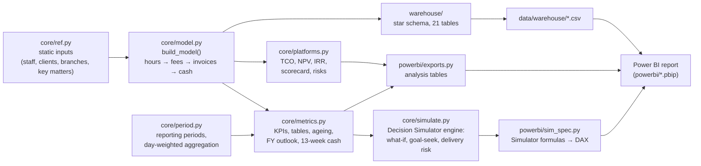

# Architecture

A deterministic financial model in Python feeds a SQL warehouse, Excel and a Power BI report. Data flows one way:

## Layers

| Layer | Files | Responsibility |
|---|---|---|
| Inputs | `core/ref.py` | Fixed reference data. Change staff, clients, branches or the as-of date here. |
| Model | `core/model.py` | Builds every monthly series, the invoice ledger, matter ledger, trust ledger and detail tables. Deterministic (fixed seed). |
| Periods | `core/period.py` | Presets, comparison windows and the day-weighted aggregation that makes any date range reconcile (exported to Power BI as month weights). |
| Metrics | `core/metrics.py` | Pure functions from (model, period) to KPIs and tables. |
| Evaluation | `core/platforms.py` | Platform cash flows, NPV/IRR/payback, scoring, sensitivity, risk register. Pure functions. |
| Simulation | `core/simulate.py` | The Decision Simulator's engine: annual what-if, goal-seek, delivery-risk range, lever ranking. Pure functions, unit-tested. |
| SQL | `warehouse/`, `sql/` | Star schema (21 tables) built from the model, data-quality suite, 14 analysis queries; queries 11–13 are tested against `metrics.py` and query 14 against `core/catchment.py`. |
| Snowflake | `snowflake/` | Setup/load and decision-query scripts generated from the local schema and queries (`generate_*.py`), loading `data/warehouse/*.csv`. |
| Excel | `excel/` | Principal's Decision Pack built from the SQL answers; Power Query scripts refresh it from the repository's CSV files. |
| Power BI | `powerbi/` | The report: TMDL semantic model over the warehouse CSVs and analysis exports, PBIR pages, the Simulator as DAX generated from `sim_spec.py`. See [POWERBI.md](POWERBI.md). |

## Design decisions

* **One source of truth.** Every number comes from `metrics.py` / `simulate.py`, which read the model. The SQL queries, the Excel
  pack and the Power BI DAX are all tested against those functions.
* **Full-month equivalents plus day weighting** rather than storing daily data: compact, fast, and exact for any date range.
  Power BI applies the same weights through the `Period Month` table.
* **Pure functions for analysis.** `metrics.py`, `platforms.py` and `simulate.py` take data in and return data out, which makes them
  easy to test.
* **The Simulator is written once.** `powerbi/sim_spec.py` holds the formulas as small expressions; they are translated to DAX and
  evaluated in Python, and the Python evaluation is tested against `simulate.py`.
* **Generated, deterministic outputs.** The warehouse CSVs, the Snowflake scripts, the Excel pack and the Power BI project are all
  generated; CI regenerates them and fails if anything changes unexpectedly.

## Extending it

* **Real data:** replace `build_model()` with a loader that returns the same structures (monthly frames `fin`, `plan`, `stock`; ledgers `inv`,
  `matters`, `trust_txns`; the detail tables; see the top of `core/model.py`), then rebuild the warehouse and the Power BI project.
* **A new report page:** add a function to `powerbi/report.py`, register it in `build_pages`, and run `python -m powerbi.build`.
* **A new Simulator lever:** add it to `core/simulate.py` (tested), then to `FORMULAS` and `build_levers` in `powerbi/sim_spec.py`.
* **A new platform:** add an entry to `PLATFORMS` in `core/platforms.py`; the exports and the report pick it up.
