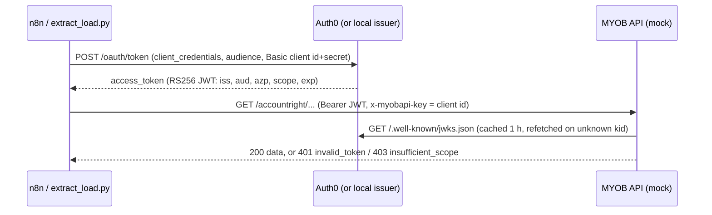

# API security: OAuth 2.0 client credentials with Auth0

The mock MYOB API (`integration/mock_api.py`) is protected the way production APIs are: a short-lived **RS256 JWT** from an
OAuth 2.0 authorisation server, checked on every request. The same code runs in two modes:

| Mode | Who issues tokens | Used for |
|---|---|---|
| `AUTH_MODE=local` (default) | Built-in issuer: `POST /oauth/token`, keys at `/.well-known/jwks.json` | Offline runs, tests, CI |
| `AUTH_MODE=auth0` | **Auth0** (free plan): `https://{AUTH0_DOMAIN}/oauth/token`, keys at `https://{AUTH0_DOMAIN}/.well-known/jwks.json` | n8n Cloud and any hosted run |

Only the issuer changes. Validation is one function, `integration/auth.py::Verifier.verify`, and `tests/test_auth.py` covers it.

## What is checked on every request

| Check | Why it matters | Test |
|---|---|---|
| Bearer token present | No anonymous access to accounting data | `test_missing_or_garbage_token_is_401_with_rfc6750_header` |
| `alg` must be RS256 | Blocks `alg: none` and HS256 "public key as secret" confusion attacks | `test_alg_none_and_hs256_confusion_are_rejected` |
| Signature valid against the issuer's JWKS (`kid`) | Forged tokens fail even with a guessed `kid` | `test_token_signed_by_another_key_is_rejected` |
| `iss` and `aud` exact | A token for another API or from another issuer is useless here | `test_wrong_audience_or_issuer_is_rejected`, `test_auth0_mode_trusts_only_the_auth0_issuer` |
| `exp` (30 s clock-skew leeway) | Stolen tokens expire; small clock drift is tolerated | `test_expired_token_is_rejected_but_clock_skew_is_tolerated` |
| Scope per resource: `read:ledger`, `read:contacts`, `read:sales` | Least privilege, so a reporting client can be limited to sales only | `test_each_resource_needs_its_own_scope`, `test_token_endpoint_only_grants_scopes_the_client_is_allowed` |
| `x-myobapi-key` = token's `azp` | Mirrors MYOB, where the API key belongs to the OAuth client | `test_api_key_header_must_match_the_tokens_client` |
| Key rotation | Unknown `kid` → JWKS refetched once, then rejected | `test_jwks_cache_refetches_once_on_unknown_kid` |

Errors follow RFC 6750 (`WWW-Authenticate: Bearer error="invalid_token"` / `"insufficient_scope"`).

**Client side.** `extract_load.py` caches the token until 60 s before it expires, shares it across runs in the same process, and
on a 401 fetches exactly one new token and retries (`test_client_reuses_one_token_across_runs_and_refreshes_once_on_401`).
In n8n, the token comes from a separate **Get Token** HTTP node whose client secret is held in an encrypted n8n
**Basic Auth credential**. The workflow JSON in git contains no secret
(`test_n8n_workflows_keep_secrets_in_credentials_not_json`).

## Set up Auth0 (free plan, no cost)

1. **Applications → APIs → Create API.** Name it `MYOB mock API` and set the identifier (the audience) to
   `https://myob-mock.dagostino-demo`. Choose signing algorithm **RS256**.
2. In that API's **Permissions** tab, add the scopes `read:ledger`, `read:contacts` and `read:sales`.
3. **Applications → Applications → Create Application → Machine to Machine**, name it `n8n MYOB loader`, and authorise it for
   the API above with all three scopes. For a reporting-only client, create a second M2M app with just `read:sales`.
4. In the M2M app's **Credentials** tab, set **Authentication Method = Client Secret (Basic)**. That is the method n8n's
   Basic Auth credential uses.
5. **n8n:** import `integration/n8n/myob_to_snowflake_cloud.json`. On **Get Token**, create a Basic Auth credential
   (user = client ID, password = client secret) and put the client ID in the **Config** node. Never paste the secret into a
   Code node.
6. **API host:** run the mock API with `AUTH_MODE=auth0`, `AUTH0_DOMAIN=dev-z1apvxcaj6hhb84a.us.auth0.com` and
   `AUTH_AUDIENCE=https://myob-mock.dagostino-demo`. In this mode its own `/oauth/token` and `/.well-known/jwks.json` return 404.
7. **Python loader:** in `.env` set `AUTH_MODE=auth0`, `AUTH0_DOMAIN`, `AUTH_AUDIENCE`, `MYOB_CLIENT_ID` and
   `MYOB_CLIENT_SECRET`. `.env` is gitignored.

**Quota.** Auth0's free plan meters machine-to-machine tokens per month (about 1,000). One daily n8n run uses one token, about
30 a month. Tests and CI never call Auth0: they use the local issuer.

## Limits

* Nothing here is MYOB's own OAuth. Live MYOB uses the authorization-code flow with a MYOB developer key (`MYOB_MODE=live`).
  Auth0 only stands in as the authorisation server for the mock.
* The end-to-end Auth0 run (real Auth0 token → hosted API) has not been executed from CI: CI has no network access to Auth0.
  The Auth0 code path is tested with a local issuer posing as Auth0 (same RS256/JWKS mechanics, Auth0-style issuer URL).
