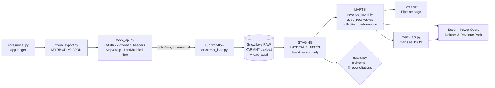

# Integration pipeline: MYOB, LEAP, triConvey, InfoTrack, TriSearch, PEXA → n8n → Snowflake → Excel / Power Query, Streamlit

The app's numbers come from a simulated model (`core/model.py`). This layer shows how the same numbers would reach the firm
if they came from its accounting system: pulled from the **MYOB Business API** on a schedule by **n8n**, landed in **Snowflake**,
modelled with SQL, checked, and served to **Excel / Power Query** and the **Streamlit** app.

**Real vs simulated.** MYOB is simulated. `integration/myob_export.py` re-shapes this app's own invoice ledger (472 invoices,
444 payments, 23 clients) into MYOB AccountRight API v2 JSON, and `integration/mock_api.py` serves it the way MYOB does.
Everything downstream (extract/load, n8n workflow, Snowflake SQL, checks, Power Query, Excel) is real code
that would run unchanged against the live API. Live MYOB access needs a MYOB developer key and the OAuth sign-in. Switching
over is configuration (`MYOB_MODE=live`, `MYOB_BASE_URL`, the client ID and the access token), not code.



## Source systems (all simulated from `core/model.py`)

| System | Role at the firm | Mock API, paging style | Fidelity |
|---|---|---|---|
| **MYOB** | Accounting: invoices, payments, chart of accounts | `/accountright/{cf}/…`, OData `$top`/`$skip` + `NextPageLink` | Field names follow MYOB's public API v2 docs |
| **LEAP** | Current practice management: matters, invoices, trust | `/leap/v1/…`, `page`/`pageSize` + `paging.nextPage` | **Illustrative**: LEAP's API reference sits behind developer registration and app review |
| **triConvey** | Smokeball-based platform, live from go-live (2 Sep 2025): migrated active matters, unpaid invoices and trust opening balances, plus native matters, invoices and disbursements | `/smokeball/…`, `Offset`/`Limit` + `next.href`, `x-api-key` | Shape follows Smokeball's public docs (`value`, `offset`, `limit`, `size`, `next`) |
| **InfoTrack** | Searches until go-live; every order carries the matter number as client reference | `/infotrack/v1/orders`, `pageNumber` + `nextPageUrl` | Illustrative |
| **TriSearch** | Searches from go-live; charges the matter when the order is placed | `/trisearch/v1/orders`, `skip`/`take` + `continuation`, scope `trisearch:read` | Illustrative: no public API documentation |
| **PEXA** | Electronic settlement workspaces on property matters | `/pexa/v1/workspaces`, cursor + `links.next` | Illustrative |

Each API pages differently, as real vendor APIs do. The loader handles them all from one table of source definitions
(`integration/extract_load.py::SOURCES`), and the n8n Config node is generated from that same table.

### Cross-system reconciliations

| Mart | Question | Result on the simulated data |
|---|---|---|
| `marts.invoice_sync_recon` | Did every LEAP invoice reach MYOB with the same total? | 472 / 472 matched |
| `marts.migration_recon` | Did every active LEAP matter arrive in triConvey exactly once? | **1 not migrated, 1 duplicated**, 12 Advisory matters fell to "General" |
| `marts.trust_migration_recon` | Do trust balances agree between LEAP and triConvey? | **Global Trust Bank short by $5,799.21** (receipt banked after the cut-over snapshot) |
| `marts.disbursements_by_matter` | What did each matter spend on searches and settlements? | 439 matters, $213,752.16 ex GST; InfoTrack and TriSearch orders joined on one normalised matter key |

The cut-over findings (full list in [TRANSITION.md](TRANSITION.md)) are planted on purpose (`integration/sources_export.py`) so the rehearsal has something to catch.
They are the kinds of issue that come up in real practice-management migrations. A test checks that the reconciliation
finds exactly these and nothing else.

## Components

| Stage | File | What it does |
|---|---|---|
| Source mapping | `integration/myob_export.py` | Model ledger → `Sale/Invoice/Service`, `Sale/CustomerPayment`, `Contact/Customer`, `GeneralLedger/Account`. Attorney → `Salesperson`, branch → `Category`, practice area → line `Job` and income account. GST rounded half-up to the cent. Deterministic UIDs (uuid5). |
| Source API | `integration/mock_api.py` | OAuth token endpoint, bearer + `x-myobapi-key` + `x-myobapi-version: v2` on every call, company-file URLs, `$top` (max 1000) / `$skip` paging with `NextPageLink`, `$filter=LastModified gt datetime'…'`. `POST /_simulate/activity` settles open invoices to demo incremental loads. |
| Security | `integration/auth.py`, [AUTH.md](AUTH.md) | OAuth 2.0 client credentials, RS256 JWT checked against the issuer's JWKS (issuer, audience, expiry, per-resource scope, API key = token client). Local issuer for CI, Auth0 for hosted runs. |
| Orchestration | `integration/n8n/*.json` (built by `build_workflows.py`) | 15 nodes: schedule → config → clear landing → read watermarks → get OAuth token (secret in an encrypted n8n credential) → extract (Code node: OAuth, paging, incremental) → insert landing → one `INSERT ALL … PARSE_JSON` into typed RAW → load audit → company-file row → fail the run if any API count ≠ rows loaded. A local Docker version and an n8n Cloud version. |
| Loader (Python) | `integration/extract_load.py` | Same contract as the n8n flow, for DuckDB (local and CI) or Snowflake (`WAREHOUSE=snowflake`). Retries 429/5xx. Watermarks only advance on an OK load. |
| Warehouse | `integration/sql/snowflake/` and `integration/sql/duckdb/` | RAW keeps the whole JSON per record. STAGING flattens and keeps the latest version (`QUALIFY row_number()`). MARTS: monthly revenue, receivables aged on the app's own buckets, collection speed by practice area. |
| Checks | `integration/quality.py` → `docs/PIPELINE_QUALITY.md` | 8 accounting checks (GST, line totals, balance = total − payments, status vs balance, referential integrity, de-duplication, payment dates, API count) and 8 reconciliations to the dashboard (report date, receivables, five ageing buckets, monthly revenue). |
| Serving | `integration/marts_api.py` | Marts as JSON (`/marts/{name}`), whitelisted names, optional API key, `/health`. |
| Excel + Power Query | `integration/powerquery/*.pq`, `integration/excel/Debtors_Revenue_Pack.xlsx` | Three M scripts: marts from the JSON API, MYOB API direct with paging, marts from Snowflake. The workbook's Summary tab is formulas only (SUMIFS, COUNTIFS, INDEX/MATCH), plus cells that check it ties to the data tab and to the dashboard. |
| Power Query reconciliation workbook | `integration/powerquery/github/*.pq`, `integration/excel/Law_Firm_Recon_PowerQuery.xlsx` | Four M queries reading the source JSON straight from this repo: LEAP + triConvey ↔ MYOB invoice sync (472/472 expected), matter migration (132 migrated, 1 not migrated, 1 duplicated), trust balance migration (Global Trust Bank short $5,799.21) and InfoTrack + TriSearch + PEXA disbursements by matter (439 matters, about $213,752). The workbook was refreshed on the earlier single-system data; the M scripts are updated for the cut-over but have not been refreshed in Excel since. |
| Streamlit | `views/pipeline.py` | The app's **Pipeline** page: flow, load audit, checks, reconciliation, ageing and collections, read from the committed snapshot in `integration/snapshot/`. |

## Run it

```bash
pip install -r requirements-pipeline.txt
python -m integration.myob_export                      # model -> integration/data/*.json (deterministic)
uvicorn integration.mock_api:app --port 8000           # keep running
python -m integration.extract_load                     # API -> DuckDB RAW (integration/law_firm.duckdb)
python -m integration.quality                          # staging + marts + checks + reconciliation -> snapshot + docs
python -m integration.excel.build_pack                 # Excel Debtors & Revenue Pack
uvicorn integration.marts_api:app --port 8001          # marts as JSON for Power Query
curl -X POST "127.0.0.1:8000/_simulate/activity?payments=5" && python -m integration.extract_load   # incremental demo
```

**Snowflake (browser only):** in a Snowsight worksheet run `integration/sql/snowflake/01_setup_and_load.sql` up to the COPY block.
Upload `integration/data/*.json` to stage `RAW.MYOB_FILES`, then run the COPY block, `02_staging.sql`, `03_marts.sql` and
`04_quality_checks.sql`. Every row of the last query must return 0.

**n8n:** import `integration/n8n/myob_to_snowflake_local.json` (Docker, `docker compose up`) or `myob_to_snowflake_cloud.json`
(n8n Cloud). Add a Snowflake credential to the Snowflake nodes. n8n Cloud needs the mock API on a public URL: set it in the
Config node.

## Limits

* The MYOB data is a re-shaped simulation, not an export from a real company file. The mock covers only the endpoints and
  behaviours listed above.
* The model does not split fees from recovered disbursements per invoice, so each MYOB invoice has one line.
* Receivables are reconciled within cent rounding (the export rounds each invoice to the cent and the app keeps full precision).
  The tolerance is about 1 cent per invoice and is stated in `docs/PIPELINE_QUALITY.md`.
