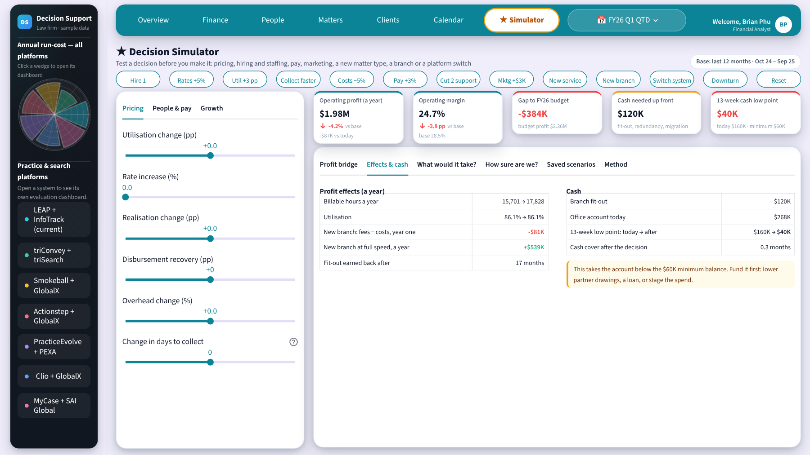

# Decision Simulator

The Simulator answers "what should we do about it?". It takes the last 12 months of actuals as the base, lets you change the levers a firm
actually controls (pricing, hiring, redundancies, a new branch, the practice-management platform) and shows the effect on profit, margin,
the gap to the FY26 budget and the cash needed up front. It fits one laptop screen: levers on the left, results on the right.

## Use it in two minutes

1. Open **★ Simulator** in the top bar (or follow a link from the Finance or People pages).
2. Click a decision in the row of buttons, or move the sliders yourself (tabs: **Pricing**, **People & pay**, **Growth**).
3. Read the five cards: operating profit, margin, **gap to FY26 budget**, **cash needed up front** and the **13-week cash low point**.
4. Open **Effects & cash** for the detail of each decision: hire break-even, pay saved and fees lost, redundancy and notice pay, branch payback.
5. Open **What would it take?**, choose a target and click **Apply** on the lever you would rather pull.
6. Check **How sure are we?** to see how much of the result depends on delivering everything.
7. **Save** the scenario, change the levers, save again and compare them in **Saved scenarios** (CSV export available).

## The levers

| Lever | Range | What it changes |
|---|---|---|
| Utilisation change | −10 to +10 pp | Billable hours of the existing team (hours scale with utilisation) |
| Rate increase | 0 to 10% | Standard rates on every hour |
| Realisation change | −5 to +5 pp | Share of standard value that is actually billed |
| Disbursement recovery change | −10 to +10 pp | Share of search and filing costs billed on to clients |
| Overhead change | −10 to +10% | All costs except fee-earner payroll and searches/filing fees |
| New fee earners | 0 to 3 | Adds pay plus about $9,000 a year overhead each; bills at the role's rate × firm utilisation × year-one productivity |
| Year-one productivity | 40 to 100% | How busy a new hire is relative to the firm average |
| Change in days to collect | −15 to +15 days | One-off cash effect only; profit is unchanged |
| Hire for (practice area) | Firm mix or one of five areas | A hire earns the area's effective rate and is as busy as the lawyers already doing that work (People → Where to hire) |
| Support department | Reception & admin, Paralegals & clerks, Accounts & trust, Marketing | Sets the pay of roles added or cut |
| Support added | 0 to 3 | Pay plus $3,000 a year each; an added paralegal frees about 200 billable hours a year for fee earners |
| Fee-earner pay / support pay | −5% to +10% | Pay review on today's team; compared with market wage growth (3.4%, ABS Wage Price Index, private sector) |
| Extra marketing a month, channel | $0 to $10,000 | Inquiries at 40% of the channel's current cost, falling as spend grows; new matters bill 35% of a typical matter in year one; capped at 95% team utilisation |
| New matter type | Wills & Estates, Family Law, Property & Conveyancing, Commercial Leasing | Fee, volume, ramp-up, staff, launch campaign (one-off cash) and ongoing marketing |
| Fee earners leaving | 0 to 2 | Saves their pay and $9,000 overhead each; loses their fees, except the share of their work the team keeps (0–80%) |
| Support roles cut | 0 to 4 | Saves the department's monthly pay each |
| Years of service of those leaving | 0 to 15 | Sets NES redundancy pay (s 119) and notice (s 117); see below |
| New branch | on / off | Associates (1–3) and support staff (1–4), rent, fit-out, months to full productivity |
| Platform | 7 options | First-year saving and one-off migration cost, taken from the platform evaluation pages |

### Redundancy and notice (National Employment Standards)

Redundancy pay follows the NES table (Fair Work Act 2009 s 119): 4 weeks after 1 year of service, rising to 16 weeks at 9 years and
back to 12 weeks from 10 years; none under 1 year. Employers with fewer than 15 employees are generally exempt; the sample firm has 25.
Notice follows s 117: 1 week up to 1 year, 2 weeks up to 3 years, 3 weeks up to 5 years, then 4 weeks (one more week for employees
over 45 with 2+ years, not modelled). Awards, enterprise agreements and contracts can give more. Both are one-off cash, not operating profit.

### New branch

Associates ramp up in a straight line to full productivity at the chosen month. Year-one fees use the average productivity over the
first 12 months. Costs are their pay plus overhead, support staff at $5,400 a month, rent and $24,000 a year of running costs.
The fit-out is capital: it is cash up front, not operating profit. Payback is the first month the cumulative contribution covers it.

## Worked example: closing the budget gap

On the sample data the base run-rate is **$2.07M** operating profit a year against a **$2.36M** FY26 budget, a gap of **$297K**.
Under **What would it take?**, with the target "Match the FY26 budget operating profit", each lever on its own would need to move by:

| Lever | Needed | Verdict |
|---|---|---|
| Utilisation | +3.7 pp (to about 90%) | Comfortable |
| Rate increase | +4.3% | Comfortable |
| Realisation | +3.9 pp | Stretch |
| Disbursement recovery | not enough on its own | n/a |
| Overheads | −14.9% | Beyond a realistic range |

Then check the risk: a 3-point utilisation improvement recovers about four-fifths of the gap, but only if it is fully delivered. Reading the
"How sure are we?" chart shows what is left if delivery is partial.

## Worked example: should we hire?

Load **Hire an associate** (one associate, 60% as busy as the firm average in year one). Year-one fees are about $406K against a cost of
$283K, a net contribution of about +$124K. The hire only covers their own cost if they reach roughly
**42%** of the firm's average productivity. If only 75% / 50% of the planned ramp-up arrives, operating profit falls to
$2.09M / $1.99M, and at 50% delivery it ends **below** the $2.07M base run-rate. The decision depends on having enough work to keep the hire busy.

## Worked example: cut roles or open a branch?

* **Cut 2 support roles** (3 years' service): +$130K a year, for $17K of redundancy pay (7 weeks each) and $5K of notice once.
  Camden is the obvious candidate on the People page: 6 support staff for 2 lawyers and the lowest margin.
* **Cut an associate** instead: about −$128K a year with none of their work kept, because a busy associate bills far more than they cost.
* **Open a branch** (2 associates, 2 support, $8,000 a month rent, $120K fit-out, full speed after 12 months): −$87K in year one,
  +$539K a year at full speed, fit-out earned back after 17 months. The $120K takes the 13-week cash low point from $160K to about $40K,
  below the $60K minimum, so it needs funding first (lower drawings, a loan or a staged fit-out).

## Worked example: pay, marketing and a new service

* **Pay rise 3% for everyone:** costs about $119K a year; **What it would take** in rates: +1.7%. Below market wage growth (3.4%) the page warns about retention risk.
* **Extra $3,000 a month on Website & SEO:** about 9 more new matters and +$40K profit in year one. The same money on LinkedIn & social loses about $14K; $10,000 a month on Website earns less than $3,000 does (diminishing returns).
* **Open Wills & Estates:** one associate, $25K launch campaign, full speed after 12 months: about break-even in year one, +$286K a year at full speed, launch earned back in 13 months. Property & Conveyancing is the weakest: −$25K in year one, 20 months to pay back.

## How the numbers are built

See [METHODOLOGY.md, section 6](METHODOLOGY.md#6-decision-simulator) for the formulas. In short:

* Base = last 12 months (1 Oct 24 – 17 Sep 25, 352 days) scaled to a full year.
* With every lever at zero the scenario equals the base exactly (tested).
* **Goal-seek** solves each lever on its own, on top of the levers already set, by bisection, then rounds the answer up to the slider step so applying it still meets the target.
* **Delivery** applies a share of the *improvements* only (including a new hire's or branch's productivity and the work kept after someone leaves); setbacks, pay and rent are never softened.
* **Cash:** every one-off cost is assumed to be paid in week one of the 13-week forecast, the worst case for the low point.

## Limits

* It is an annual what-if, not a month-by-month forecast; it does not model timing, seasonality or the cost of recruiting delays.
* It holds client behaviour, matter mix and volumes constant apart from the levers, and assumes there is enough work for any new hire.
* The utilisation lever is capped by what is physically possible (goal-seek never proposes more than 100% utilisation or realisation), and above about 95% the page warns that it is unlikely to be sustainable.
* Results are only as good as the base data; the sample data is synthetic.
