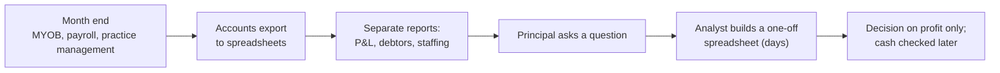
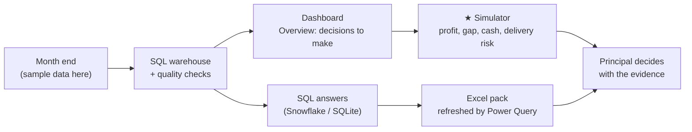

# The monthly decision process

## As-is

**Gaps:** each question is answered from a different extract; numbers do not reconcile across reports; no view of cash at the time
of the decision; assumptions sit inside spreadsheets nobody else reads.

## To-be

## Controls

| Control | What it prevents | Where |
|---|---|---|
| One model feeds every page, the SQL and the Excel pack | Two answers to the same question | Reconciliation tests in `tests/` |
| Data-quality suite on the warehouse (completeness, keys, business rules, reconciliation to the app) | Decisions on broken data | `warehouse/quality.py`, `docs/DATA_QUALITY.md` |
| SQL answers tested against the dashboard's numbers | SQL and dashboard drifting apart | `tests/test_sql_queries.py` |
| Cash impact shown with every decision | Profitable decisions that run out of cash | Simulator KPI row |
| Assumptions in one file, shown in the app | Hidden optimism | `core/ref.py`, Simulator → Method |
| NES minimums applied to every redundancy | Underpaying entitlements | `core/simulate.py`, tested |
