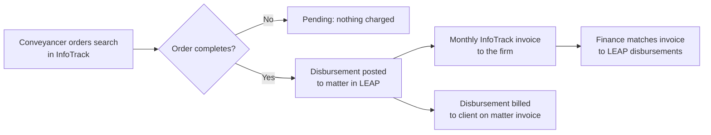
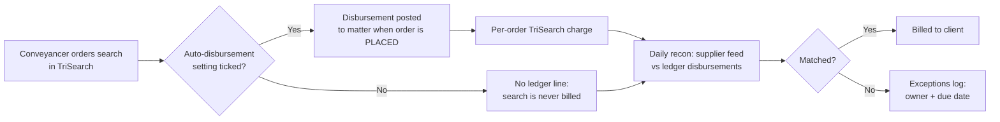
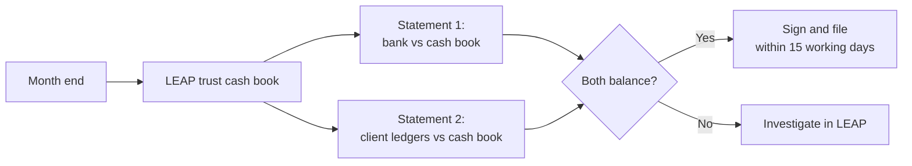
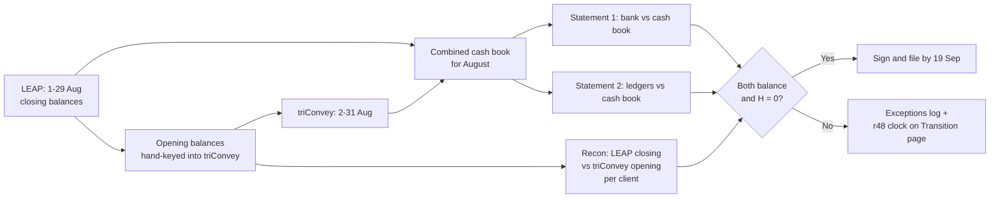

# Process maps: as-is, to-be and gaps

Two processes change at the cut-over: **ordering and billing a property search**, and **the month-end trust
reconciliation**. The diagrams render on GitHub (Mermaid).

## 1. Search order to bill

### As-is (InfoTrack, before 2 Sep 2025)

### To-be (TriSearch, from 2 Sep 2025)

### Gaps

| # | Change | Risk | Control added | Requirement |
|---|---|---|---|---|
| G1 | Charge moves from *completion* to *placement* | Timing differences look like errors | Recon class "Timing" for incomplete InfoTrack orders | BR-08 |
| G2 | Charging depends on a user setting | Orders with no ledger line (18 found on 8–9 Sep) | Daily supplier-vs-ledger recon | BR-08 |
| G3 | Monthly invoice becomes per-order | No month-end control total any more | Feed total vs ledger total in `marts.supplier_switch_summary` | BR-08 |
| G4 | Orders in the buffer window re-keyed by hand | Missing, duplicated or GST-inclusive amounts | Classified as "Duplicate in ledger" / "Amount differs" | BR-08 |
| G5 | References re-typed | False mismatches | Reference normalisation before matching | BR-09 |
| G6 | Staff keep using InfoTrack out of habit | Orders on the old supplier after go-live | Stragglers flagged in the switch summary | BR-08 |

## 2. August trust reconciliation (r48)

### As-is (one system)

### To-be for August 2025 (two systems)

### Gaps

| # | Change | Risk | Control added | Requirement |
|---|---|---|---|---|
| G7 | Opening balances are hand-keyed | A receipt posted after the extract is lost: Global Trust Bank $5,799.21 short | Per-client LEAP closing vs triConvey opening | BR-05 |
| G8 | August spans two systems | Neither system can produce statement 2 alone | Combined August cash book across both systems | BR-06 |
| G9 | The deadline does not move for a migration | Late lodgement while staff learn the new system | Working-days-left clock on the Transition page | BR-06, BR-13 |
| G10 | A short opening balance can push a ledger into debit | r40(2) breach from the first dollar | Ledger-never-negative test | BR-07 |
